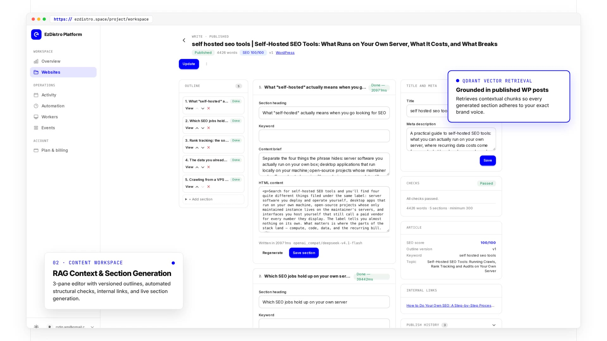

<p align="center">
  
</p>

<h1 align="center">EzDistro</h1>

<p align="center">
  <strong>Self-hosted SEO content automation</strong><br>
  Index your WordPress content, write retrieval-grounded articles with your own LLM,<br>
  review them, publish them — no Redis, no Celery, no n8n.
</p>

<p align="center">
  <a href="https://github.com/Rastin-Amani/EzDistro/actions/workflows/ci.yml"></a>
  <a href="LICENSE"></a>
  <a href="https://github.com/Rastin-Amani/EzDistro/releases"></a>
  <a href="https://github.com/Rastin-Amani/EzDistro/pkgs/container/ezdistro"></a>
  <a href="https://github.com/Rastin-Amani/EzDistro/stargazers"></a>
  <a href="https://github.com/Rastin-Amani/EzDistro/commits/main"></a>
</p>

<p align="center">
  <a href="https://www.python.org/"></a>
  <a href="https://fastapi.tiangolo.com/"></a>
  <a href="https://htmx.org/"></a>
  <a href="https://pocketbase.io/"></a>
  <a href="https://qdrant.tech/"></a>
  <a href="https://wordpress.org/"></a>
  <a href="docs/OPERATIONS.md#docker"></a>
  <a href="#stack"></a>
</p>

<p align="center">
  <a href="docs/OPERATIONS.md"></a>
  <a href="docs/ARCHITECTURE.md"></a>
  <a href="docs/ARCHITECTURE.md"></a>
  <a href="docs/ARCHITECTURE.md"></a>
  <a href="https://www.conventionalcommits.org/"></a>
  <a href="CONTRIBUTING.md"></a>
</p>

<p align="center">
  <a href="https://ezdistro.space/en/">Website</a> ·
  <a href="https://ezdistro.space/en/how-it-works">How it works</a> ·
  <a href="https://ezdistro.space/en/features">Features</a> ·
  <a href="https://ezdistro.space/en/self-hosting">Self-hosting</a> ·
  <a href="https://ezdistro.space/en/integrations">Integrations</a> ·
  <a href="https://ezdistro.space/en/pricing">Pricing</a> ·
  <a href="https://ezdistro.space/en/faq">FAQ</a> ·
  <a href="docs/README.md">Docs</a>
</p>

Production-grade, reusable SEO automation platform: fetch WordPress posts, chunk and embed
them into Qdrant ([Indexer](https://ezdistro.space/en/features/indexer)), write fully-formed articles section by
section with an LLM, and publish them back to WordPress ([Writer](https://ezdistro.space/en/features/writer)) —
one loop, on your own server, owned end to end.

Built as a **modular monolith**: FastAPI + HTMX + DaisyUI (PWA) front end,
PocketBase as the source of truth, Qdrant for vectors, and pluggable cloud providers for
LLM / embeddings / reranking / publishing. No Redis, no Celery, no n8n.

Architecture, data model, job-state design and provider interfaces: see [docs/ARCHITECTURE.md](docs/ARCHITECTURE.md).

## Demo

<p align="center">
  <a href=".github/assets/videos/ezdistro-demo.mp4">
    
  </a>
  <br>
  <sub><b>▶ <a href=".github/assets/videos/ezdistro-demo.mp4">Watch the demo</a></b> — 53 s, with audio: research, the RAG writing workspace, and the review + automation loop, in the real UI.</sub>
</p>

GitHub plays the file when you open it (that link is the video, not a still). Individual screens are below.

## Contents

- [Demo](#demo)
- [Screenshots](#screenshots)
- [Features](#features)
- [Stack](#stack)
- [Data model](#data-model)
- [Quick start](#quick-start)
  - [Container image](#container-image)
  - [Workflow](#workflow)
- [Who it is for](#who-it-is-for)
- [How it compares](#how-it-compares)
- [Development](#development)
- [Interface language](#interface-language)
- [Process model](#process-model)
- [Documentation & contributing](#documentation--contributing)
- [License](#license)

## Screenshots

**Writing workspace** — outline navigation, section editor and the checks that gate publishing, in one screen.


**Review gate** — structural checks and editorial QA decide whether Publish is enabled.


**Overview** — pipeline state across every site you run, with what needs a human first.


**Activity** — durable jobs with live progress, retries and the reason a task stopped.


---

## Features

- **[Production content workspace](https://ezdistro.space/en/features/review-publishing)**: 3-pane article editor (outline navigation /
  content+section editor / metadata+SEO+links+status), live section-generation
  progress with elapsed time, versioned outline editing (move/add/delete/brief),
  bulk topic management with search/filter/sort/pagination, pipeline dashboard
  with indexing + provider health, custom `ezdistro` DaisyUI theme.

- **[Multi-project](https://ezdistro.space/en/features/projects)**: every project has its own WordPress config, Qdrant namespace,
  embedding provider/model/dimensions, LLM provider/model, prompts, SEO rules, writing
  style, language, chunking, retrieval & reranking, publishing mode, concurrency,
  schedules and internal-linking rules — all configurable from the UI.
- **[Persistent async jobs](https://ezdistro.space/en/features/jobs) on PocketBase** (no Redis):
  - atomic lease-based claiming via a unique-constrained `job_leases` collection
  - lease expiry → abandoned-job recovery
  - retries with exponential backoff + jitter, honoring provider Retry-After
  - cooperative cancellation (UI button → handler checkpoints, graceful)
  - progress % + stage + current/total items; canonical lifecycle events
    (job.created → job.claimed → job.started → job.stage_* → job.completed/failed/cancelled)
  - bounded provider concurrency (LLM / embeddings / publishing rate limits)
  - idempotency keys; no duplicated irreversible operations (publish guard)
  - 19 registered job types: 10 content/indexing types (index_project,
    index_document, write_article, generate_outline, generate_section,
    assemble_article, publish_article, notify_search_engines,
    build_internal_links, retry_failed_job), 6 image-pipeline types (plan_article_images, generate_cover_image,
    generate_interior_image, generate_article_image, optimize_article_image,
    publish_article_image) and 3 research types (research_run, wordpress_sync,
    analyze_landing_page)
- **[Indexer job](https://ezdistro.space/en/features/indexer)** (`index_run`): fetch WP posts (id-ordered, resumable) → strip HTML →
  chunk (size/overlap per project) → batch embed → upsert Qdrant (stable point ids) →
  per-post content-hash metadata; unchanged posts are skipped; crashed runs resume
  from `lastWpId`.
- **[Writer job](https://ezdistro.space/en/features/writer)** (`write_article`): pick pending topic → retrieve related docs →
  internal-link context → LLM outline **validated by pydantic schema** → section records →
  per-section generation with bounded concurrency → sanitized HTML assembly →
  chains a `publish_article` job.
- **[Publish job](https://ezdistro.space/en/features/review-publishing)** (`publish_article`): WordPress REST (application passwords), draft or
  live, idempotent (consults `publishing` records before calling WP). Uploads ready
  article images to the WP media library idempotently, resolves placeholders, and
  attaches the cover as the post featured image (missing cover blocks publish unless
  overridden with `publishWithoutCover`).
- **[Image pipeline](https://ezdistro.space/en/features/images)** (`plan_article_images` → `generate_cover/interior_image` →
  `optimize_article_image`): LLM-planned cover + purposeful interior images (density
  capped by word count, max 4), generated via the project's image providers with
  fallback, quality-gated (dimensions/format decoded before storage), optimized to
  WebP/AVIF/JPEG + small variant, versioned per slot (regenerate creates version+1,
  never overwrites). Auto-chained from `assemble_article`; manageable from the
  article workspace **images pane** and the project **Article images** settings tab
  (includes a one-click generation test).
- **Internal link building** (`build_internal_links`): after publishing, the
  retrieval store locates the already-published pages most related to the new
  article and adds one contextual inbound link to each (up to three). The edit is
  text-preserving — it only wraps an existing occurrence of the article's keyword
  or title, never rewrites prose, never nests a link.
- **Landing-page analysis** (`analyze_landing_page`): fetch the brand's own
  landing page, extract a factual product profile, and feed it to every research,
  outline and section prompt so the writing knows what the site sells.
- **[SEO research engine](https://ezdistro.space/en/features/research)** (`research_run`): Google Ads Keyword Planner data (OAuth,
  per-project client) or an uploaded Keyword Planner CSV/XLSX file → WordPress mirror
  (`wordpress_sync`) → competitor crawl → clustering (deterministic / embedding / LLM)
  → content gaps → transparent `GENERATE`/`UPDATE`/`EXPAND`/`SUPPORT`/`REJECT`
  opportunities → one-click handoff to the existing writer. Facts-first: it never
  invents volume/CPC/competition. Optional SERP provider; degrades gracefully without
  Google Ads, SERP or LLM. There is a [research engine walkthrough](https://ezdistro.space/en/how-to/research-engine) on the site and the
technical detail in [docs/SEO_RESEARCH.md](docs/SEO_RESEARCH.md).
- **[Scheduler](https://ezdistro.space/en/how-it-works)**: per-project interval schedules → idempotent job creation (per-window keys).
- **[Security](https://ezdistro.space/en/security)**: Fernet-encrypted credentials at rest (masked in UI, never plaintext),
  SSRF guard on all provider URLs, HTML sanitization (bleach allowlist), HX-Request
  checks on mutations, per-project access control.
- **Observability**: structured logs (structlog) with correlation ids (web) / job ids
  (worker); per-job and per-project event feeds in the UI.

## Stack

| Layer | Technology |
|---|---|
| Web | FastAPI, Jinja2, HTMX 2, Alpine.js (minimal), DaisyUI 5, Tailwind 4, PWA |
| Source of truth | PocketBase (≥ 0.23) — schema: [docs/SCHEMA.md](docs/SCHEMA.md) |
| Vectors | [Qdrant](https://ezdistro.space/en/features/retrieval) (HTTP) |
| LLM / embeddings / rerank / images | [Provider registry](https://ezdistro.space/en/features/providers): OpenAI-compatible chat (generate/json/stream), native Gemini, **Cohere Embed v4.0** (search_document/search_query), Cohere-compatible rerank, image generation (`gemini` / `bfl` FLUX / `openai_compat`) — selectable per project from the UI |
| Publishing | WordPress REST API ([approval gate + idempotent publish](https://ezdistro.space/en/features/review-publishing)) |
| Worker | Standalone asyncio process (`python -m app.workers.worker`) |

## Data model

The PocketBase schema is designed around the product domain (not the old n8n
workflows; the [reference](https://ezdistro.space/en/docs) is generated from it): **39 collections**
covering projects, flat project settings (incl. image-generation, multilingual and
landing-page config), configurable integrations (encrypted secrets; categories incl.
`image`, `serp`, `google_ads`, `keyword_source`), versioned prompts (incl.
`image_plan_*`, `research_*`, `cluster_*`, `opportunity_*`, `category_*`), topics
with a full editorial pipeline, articles + sections (the outline IS the
ordered section rows; WordPress-mirror fields for `wordpress_sync`), article
revisions (append-only history), article images (versioned generations +
optimized files), indexed documents, index runs, the job engine (jobs / atomic
leases / append-only job events), publishing runs (publish audit, one row per attempt),
provider metrics, schedules, worker heartbeats and project memberships (plus the
built-in `users` collection extended with `role`/`displayName`), **plus 13 SEO
research collections** (`google_ads_connections`, `google_ads_customers`,
`research_runs`, `research_seeds`, `keywords`, `keyword_metrics`,
`keyword_volumes`, `clusters`, `competitor_pages`, `content_gaps`,
`article_ideas`, `serp_queries`, `serp_results`), **plus 6 billing collections**
(`billing_products`, `billing_entitlements`, `billing_invoices`,
`billing_payment_events`, `billing_usage`, `credit_transactions`).
Relationships, cascades, uniqueness and the indexing strategy:
[docs/SCHEMA.md](docs/SCHEMA.md).

## Quick start

```bash
# 1. Python + JS deps
pip install -r requirements.txt
npm install && npm run css:build

# 2. Configure
cp .env.example .env            # PB_URL, PB_ADMIN_EMAIL/PASSWORD, SECRETS_KEY,
                                # PUBLIC_APP_URL + Google/GitHub OAuth credentials

# 3. Bootstrap PocketBase collections (idempotent)
make bootstrap

# 4. Run the two processes (independently)
make web                        # uvicorn app.main:app --port 8000
make worker                     # python -m app.workers.worker
```

### Container image

Prebuilt images for `linux/amd64` and `linux/arm64` are published to GitHub
Container Registry from `main` and from every release tag — no local build needed:

```bash
docker pull ghcr.io/rastin-amani/ezdistro:latest
docker run --env-file .env -p 8000:8000 ghcr.io/rastin-amani/ezdistro:latest
```

The image runs the web process plus a pool of `WORKERS` worker processes (default 4)
in one container; see [docs/OPERATIONS.md](docs/OPERATIONS.md#docker).

Sign in or create an account with Google or GitHub (there is no password login).
Register the app’s `/auth/oauth2/callback` URL at both providers before the first
sign-in (the app builds it from the public origin it is served on); see
[docs/CONFIGURATION.md](docs/CONFIGURATION.md#sign-in-oauth-only-google--github).

### Workflow

New here? The [first-article walkthrough](https://ezdistro.space/en/how-to/first-article) follows these steps with screenshots.

1. Create a **project**.
2. **Advanced → Connections**: add active credentials — WordPress (site URL + username +
   application password), LLM (base URL + API key), Embedding (base URL + key),
   Qdrant (URL, optional key), Reranker (optional).
3. **Website setup**: embedding model/dimensions, chunk size/overlap, retrieval
   top-k/threshold, rerank, LLM model/temperature, section concurrency, retry policy,
   publishing mode, SEO rules, routines.
4. **[Writing rules](https://ezdistro.space/en/features/prompts)** (Advanced): system / outline / section / SEO prompts (per-project; global
   defaults seeded by bootstrap).
5. **Content plan** tab: add topics (manually or bulk-import CSV/TSV), click **Write**
   → writer job → article appears in **Articles** (edit outline/sections there) →
   publish job → live/draft on WordPress.
6. **Find opportunities** tab (optional): harvest autocomplete keywords for free,
   connect Google Ads on **Connections** (or upload a Keyword Planner CSV/XLSX),
   run research, then accept opportunities to feed the content plan.
7. **Activity** and **Events** tabs: monitor, cancel, retry (the **Problems**
   dead-letter view opens from **Overview** or `/failed`).
8. **Site health** tab (**Full reindex** button) or an **Automation** routine: index
   WordPress posts into Qdrant.

Already running another stack? See [migrating to EzDistro](https://ezdistro.space/en/migrate) and the
[integration list](https://ezdistro.space/en/integrations).

The documentation set in `docs/` is also served in-app at `/help/` (auth-gated) —
the Find opportunities tab's **How this works** link points there.

## Who it is for

- **[Solo operators](https://ezdistro.space/en/for/solo-operators)** — one or two sites, your own provider keys, everything
  on one box.
- **[Agencies](https://ezdistro.space/en/for/agencies)** — many client sites, each with its own voice, prompts and schedule.
- **[Content refresh](https://ezdistro.space/en/for/content-refresh)** — improve pages that already rank instead of only
  publishing new ones.
- **[Multilingual publishing](https://ezdistro.space/en/for/multilingual)** — one project per market and locale.

## How it compares

| If you are weighing | Read |
|---|---|
| n8n / Make workflows | [EzDistro vs n8n](https://ezdistro.space/en/vs/n8n) — durable jobs and an editorial UI instead of hand-built flows |
| Jasper, Copy.ai and AI writers | [EzDistro vs AI writers](https://ezdistro.space/en/vs/ai-writers) — retrieval-grounded drafts plus the publishing pipeline |
| Yoast, Rank Math and SEO plugins | [EzDistro vs SEO plugins](https://ezdistro.space/en/vs/seo-plugins) — they optimise a page, this writes and ships it |
| Freelance writers | [EzDistro vs freelancers](https://ezdistro.space/en/vs/freelancers) — cost and throughput, with a human approval gate |
| Gluing scripts together | [EzDistro vs DIY scripts](https://ezdistro.space/en/vs/diy-scripts) |
| Chatting with an LLM | [EzDistro vs ChatGPT](https://ezdistro.space/en/vs/chatgpt) — context from your own site, not a blank prompt |

Self-hosted is free and unmetered with your own provider keys; the managed cloud is
optional — see [pricing](https://ezdistro.space/en/pricing), the [security model](https://ezdistro.space/en/security) and the
[privacy](https://ezdistro.space/en/privacy) and [terms](https://ezdistro.space/en/terms) of the hosted service.

## Development

```bash
make test          # pytest
make lint          # ruff check + format check
make typecheck     # mypy app/
make check         # all three
```

CI (`.github/workflows/ci.yml`) runs the same four steps on every push to `main`
and on every pull request, on Python 3.12.

## Interface language

The UI is **English-only**. Dates and numbers render through the `loc_*` filters in
`app/templates.py`: Gregorian dates via Babel and thousands-grouped integers via
`loc_int`. Layouts use logical properties, so markup stays direction-agnostic.

Machine-readable enum values stay unformatted; display labels are plain English strings.

Content language is a per-project setting (one project per market), covered in
[multilingual publishing](https://ezdistro.space/en/for/multilingual).

## Process model

```
┌────────────────────┐     ┌─────────────────────┐
│  Web (uvicorn)     │     │  Worker (asyncio)   │
│  HTMX UI + API     │     │  poll → claim → run │
│  creates jobs      │     │  heartbeat/retry/   │
│  (idempotent)      │     │  cancel/progress    │
└─────────┬──────────┘     └──────────┬──────────┘
          │            PocketBase     │
          └──────────── (source of    ┘
                        truth)    Qdrant / LLM / WP (providers)
```

Web and worker are fully independent; run any number of workers (atomic claiming +
leases make multi-worker safe).

## Documentation & contributing

- Product documentation: [ezdistro.space/docs](https://ezdistro.space/en/docs) · common questions: [FAQ](https://ezdistro.space/en/faq).
- Full docs index: [docs/README.md](docs/README.md) — also served in-app at
  `/help/` (auth-gated).
- Architecture, schema, configuration, operations, failure modes and the SEO
  research engine: [`docs/`](docs/README.md).
- Setup, checks, architecture rules and the schema workflow: [CONTRIBUTING.md](CONTRIBUTING.md).
- Optional billing/plans (off by default for self-hosters): [docs/BILLING.md](docs/BILLING.md).
- Release history: [CHANGELOG.md](CHANGELOG.md).
- Security model and how to report a vulnerability: [SECURITY.md](SECURITY.md).
- Background: [what EzDistro is](https://ezdistro.space/en/about) and [what is coming next](https://ezdistro.space/en/roadmap).

## License

Apache License 2.0 — see [LICENSE](LICENSE). Copyright 2026 Rastin Amani.
